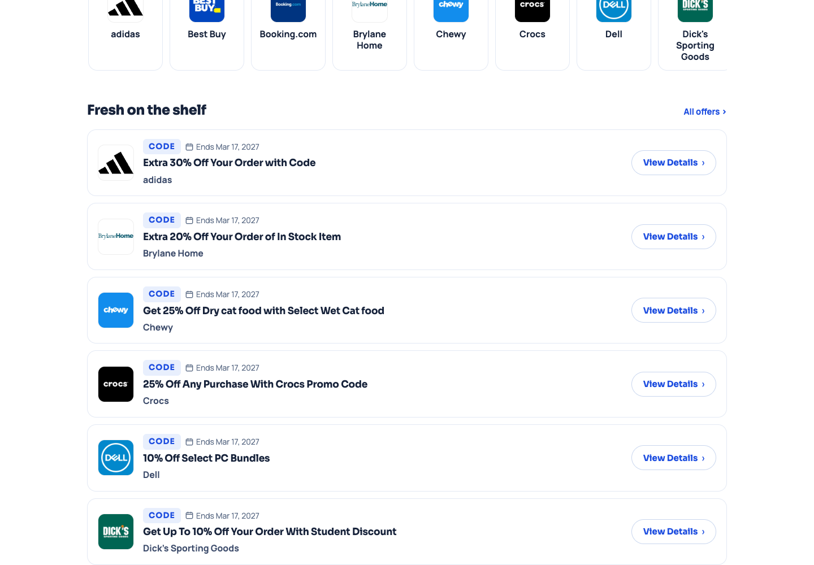
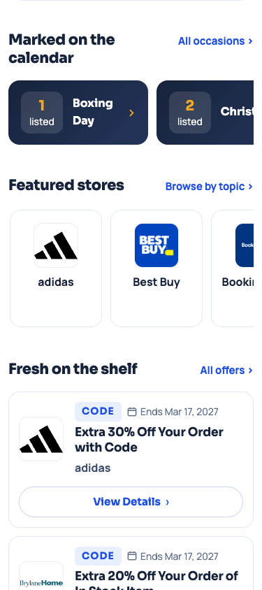
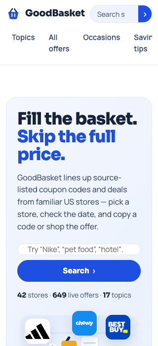

# GoodBasket：经验已读取，制作与审查仍失效

当前方向被用户明确拒绝；这是负例，不是优秀模板或已验证的修复方法。2026-10-13，goodbasket-trial-20261013，build b-5c7938bb-2a01-4688-a169-677c1839ea86。独立只读审核 round-e6eacb4a-1f9d-46df-a5a3-c11229b972f8 完成首页方向7/7检查，决定revise；未做完整全站验收。

## 已证实的失效

- 作者收到6张桌面参考图和自己的真实图片，仍一次写完全站；第一个方向候选已有848页，首次本站浏览在全量构建后。
- 没有看手机参考、没有滚动查看第二屏。handoff观察主要是字号、0失败、无溢出，不能证明商业完成度。
- 独立实看确认4个主要视觉问题：通用篮子图形与口号没有有效优惠构图；桌面通栏白色券行缺少区域与卡片设计；手机整个券前内容较长；320px导航裁切。手机卡片较桌面更完整，不能笼统说每端卡片都无设计。
- 数值自检先全部通过才能交审的旧入口，让3批修复消耗在路径/绑定/字号，审美审核没机会开始。新入口记录阻塞并进入reviewOnly；这种候选不能ready/pass/release。

## 实际下一步的方法

在代表首页的桌面、手机与第二屏上先作制作决定、看实际优惠曝光与入口，再让独立角色完整对照参考并给一个集中包；方向成立后才扩展。数据、业务正确性与诊断正确性分别证明。更改画面只需处理本候选的具体问题，不强制下一站使用照片、票券缺口、固定列数或同一皮肤。

这是方法与调度修正，尚未证明新的生成已经成功；不能把读完本案例写成“能力已提升”。

## 诊断也需要反证

横向rail在未显露区域的懒加载Logo被误报为可见图片缺失；显露后全部正常，已归为测量范围问题，不能派网页返工。画面padding与外框gutter测量不一致，仍是冻结门禁问题，不能冒称视觉留白不存在。桌面约1900px才出首券的初稿估算也错误：950px滚动图内已出现券；闭合历史保留，独立审核者另存勘误。不要迎合拒绝反馈而编造缺陷、夸大距离或把机器报错都当成视觉问题。

下面是独立审核者的原始帧。frames.json保存完整receipt、actor、build、route、width、scroll与SHA-256，图像未修改。

完整解释和代码验证见应用docs/GOODBASKET-AUTO-REVIEW-2026-10-13.md；本案例不改变历史候选的冻结政策、也不宣称已稳定生成。
